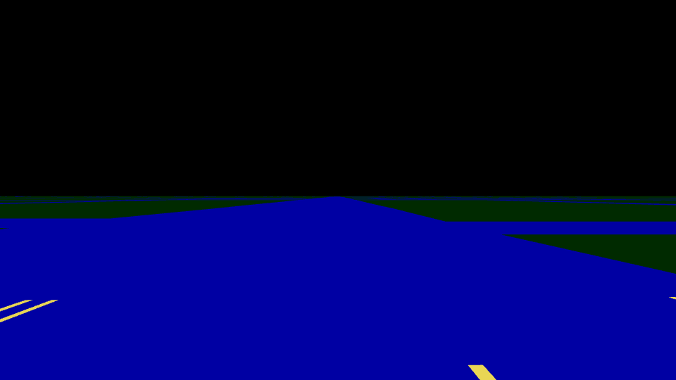
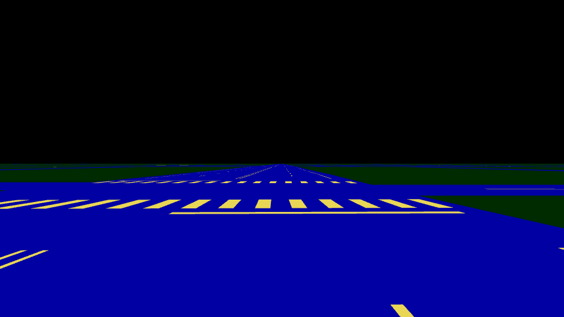
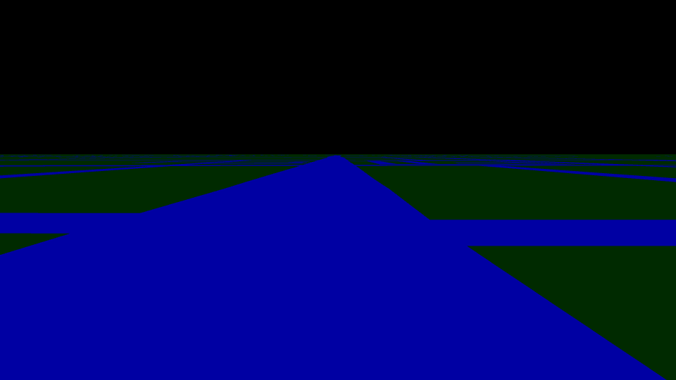
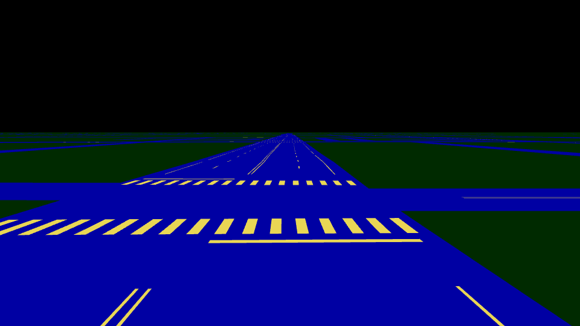

# v0.8.2: restore depth after reflection and capture resets

The moving street-paint cutoff has a reproducible renderer-state cause. Three r180's `resetState()` restores ordinary clip control and a native clear depth of 1. Our reflection cleanup called it after configuring materials for reversed depth, without restoring the renderer's configured convention. The first main camera therefore used ordinary depth with positive, reversed-depth paint offsets. A later reset could leave an already-reversed camera projection paired with ordinary depth comparison.

This investigation fixes that concrete defect and a separately measured paint-bias edge leak. A full-scene sweep on Trent's physical GPU remains unverified. The images below are native diagnostic renders, not browser screenshots.

## Production changes

- `src/app/renderer.js` owns `resetRendererState()`. It resets cached state, restores the configured reversed/ordinary convention, and explicitly sets logical far clear depth. In reversed mode this becomes native clear depth 0. Calling `setReversed(true)` alone is insufficient because Three's reset also invalidates its cached clear value.
- Reflection cleanup in `src/sky.js` and photograph setup in `src/app/captures.js` use the shared helper. Render targets, viewport/scissor restoration, exposure, lighting and reflection quality retain their existing behavior.
- `src/world/paint-material.js` retains depth testing, after-opaque rendering, and disabled paint depth writes. Its offset is now units-only: slope factor 0, ordinary units −2, reversed units +2. The former slope factor caused a measured close-occluder leak; removing it preserves all tested paint coverage.
- Geometry, paint heights, the 16 km ground plane, streaming, driving, GPU UI and saved setup formats are unchanged. There is no additional per-frame pass, draw call, texture, geometry allocation or network asset.

## Reproduction and controls

The immutable baseline is source/docs commit `6f635288c98c31e12d32392340ad1ba3e5289e29`, whose runtime is v0.8.1. Its restored packed geometry SHA-256 is `a1794afb7d758d0fd28e67f8525e805e60f4b117c02a786e4b2b109f8dcf9eb6`.

The old native fixture cleared the material-created group, accidentally omitting the Prairie ground depth owner. The expanded fixture retains its actual two-triangle geometry, 16 km extent, material and transform. It also adds six close chase, driver and orbit views to the original eight. It uses actual pinned Three MeshStandard programs, packed road buffers and Float32 paint instances. Diagnostic emission identifies coverage; appearance textures, lighting and shadows remain outside its scope.

| Native configuration | Cases | Expected paint pixels | Missing paint pixels | Paint through occluder |
| --- | ---: | ---: | ---: | ---: |
| Historical reset, fresh ordinary camera | 56 | 456,402 | 428,716 | 0 |
| Historical reset, already-reversed camera | 56 | 456,402 | 456,402 | 0 |
| Restored depth, original slope bias | 84 | 684,603 | 0 | 162 |
| Restored depth, production units-only bias | 84 | 684,603 | 0 | 0 |

The corrected configuration also has zero surface-interior draw-order changes and passes 35,205 occluder-overlap pixels. Ordinary logarithmic 24-bit, reversed 24-bit, reversed 32-bit float, single-sample and 4× MSAA modes are covered. Fifteen actual program variants compile and link.

These counts aggregate fixed test cases; they are not a percentage of a browser frame or a measurement of frame rate. The fresh-camera and already-reversed-camera controls deliberately emulate the broken reset state. Five focused Node regressions separately execute actual Three WebGLState and its actual camera projection-upload code, including the real reflection and capture entry points. Four material regressions cover all downtown and streamed paint factories. Those tests connect the native state reproduction to the repaired runtime calls.

### Same camera, same geometry

Diagnostic colors are blue road, yellow paint and dark green Prairie ground. The comparison changes renderer depth state and paint bias; the city geometry and camera are identical.

| Close driver before | Close driver after |
| --- | --- |
|  |  |

| Close chase before | Close chase after |
| --- | --- |
|  |  |

### Explicit horizon boundary metric

The floor-inclusive test finds 166 raw draw-order differences across three logarithmic 4× MSAA cases. They are confined to one horizon row per affected view. A separate native, true single-sample render of the identical near/far-clipped opaque geometry has no pixel-center coverage at those coordinates, and the paint-only reference has no coverage there. Independent center-ray calculations point upward and intersect the road/floor planes behind the camera, with zero valid near/far hits.

These partially covered sample-boundary pixels are reported separately, with their raw count, bounds, ray evidence and image masks retained. They are not called zero or silently removed. Every changed surface-interior pixel, changed paint pixel, hidden paint pixel and occluder leak remains a strict failure. Subdividing the Prairie ground into 64×64 cells produced pixel-identical results in all nine selected comparison cases, so no subdivision is retained.

The actual Devon plaza tops were checked against all 14,391 Float32 paint rectangles: zero touches or overlaps. Neither an added floor lift nor a speculative paint-mask rewrite is justified by these controls.

## Evidence

- [Summary and image hashes](summary.json)
- [Historical fresh-camera reset failure](startup-reset-before.json)
- [Historical already-reversed-camera reset failure](stale-camera-reset-before.json)
- [Restored depth with original slope bias](restored-state-original-bias.json)
- [Current source, no diagnostic overrides](current-source.json)
- [Final built output, no diagnostic overrides](current-build.json)
- [All 165 generated paint images match](image-parity.json)
- [Complete local check log](local-check.txt)
- [Sunset shader gate](sunset.json), [generic depth gate](generic-depth.json), and [UI/map gate](ui-map.json)
- [Isolated units-only bias control](factor-zero-control.json)
- [Ground subdivision control](floor-subdivision-control.json)

The reports retain per-case results, geometry/source/shader hashes, renderer identity and diagnostic scope. The native renderer is Mesa llvmpipe; this is not hardware-browser or physical-phone validation.

## Re-run

After installing the pinned requirements and building the candidate:

```sh
node --test src/app/renderer.test.mjs src/world/paint-material.test.mjs
node scripts/visual/prepare-paint-depth-diagnostics.mjs --output qa/depth-reset-current
python scripts/visual/check-paint-depth-gles.py --input qa/depth-reset-current --output qa/depth-reset-current/captures
```

To reproduce the historical failure, separately build the immutable v0.8.1 baseline and use its actual runtime materials as well as its data:

```sh
node scripts/visual/prepare-paint-depth-diagnostics.mjs --baseline-dist /absolute/path/to/v081/dist --output qa/depth-reset-baseline
python scripts/visual/check-paint-depth-gles.py --input qa/depth-reset-baseline --output qa/depth-reset-baseline/fresh-camera --depth-state reset-ordinary-camera --record-only
python scripts/visual/check-paint-depth-gles.py --input qa/depth-reset-baseline --output qa/depth-reset-baseline/stale-camera --depth-state reset-stale-reversed-camera --record-only
```

`--record-only` is intentional for failing historical controls. It is not used for the corrected release gate. The final `npm run build` and complete `npm run check` pass. The built paint gate passes all 84 cases; all 165 generated paint images match the source run byte-for-byte. The additional native gates pass 18 sunset/glass/facade programs, 4 generic depth cases, and 8 UI/map programs with 7 fixtures. The built-app integration gate drives 216.891 m over 10 seconds with 285 repeated key events and checks 390 × 844 / 844 × 390 phone control layouts through adapters. Publication status is recorded separately in `HANDOFF.md`.

## Browser limit

The current cloud browser opens the restored app preview but reports WebGL2 unavailable and uses the map fallback. The public domain returns a generic 403 in that browser. These restrictions prevent a full browser 3D sweep here. They do not establish that the public site is down or that Trent's browser is blocked. CI publication and the public asset hash audit verify deployment independently; the physical-GPU visual check remains a separate limit.
