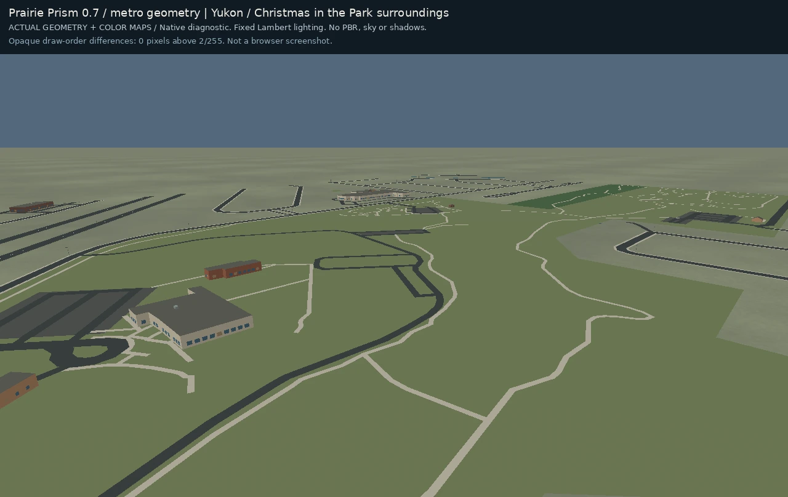
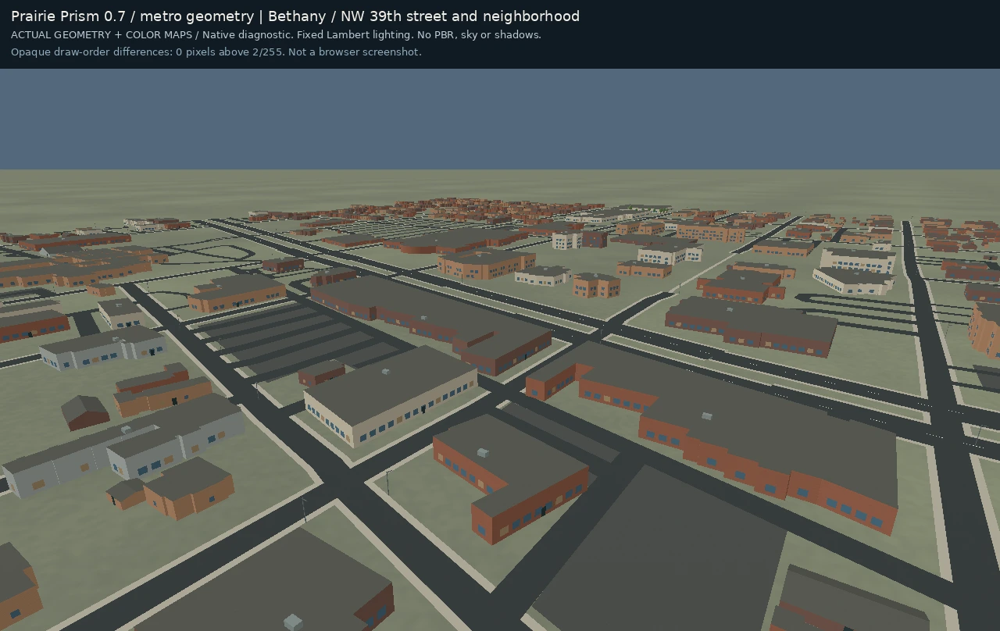
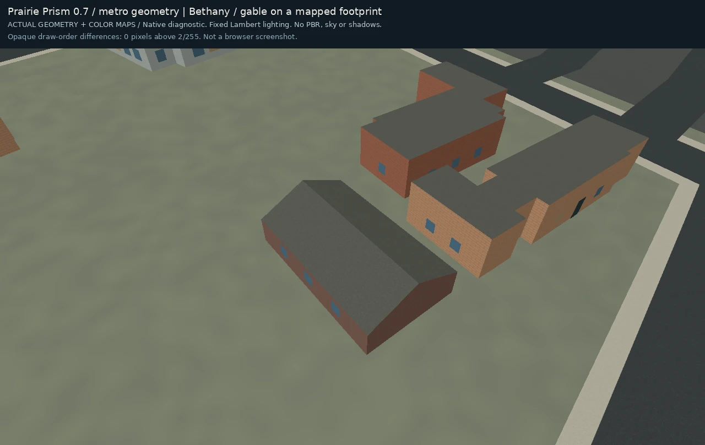
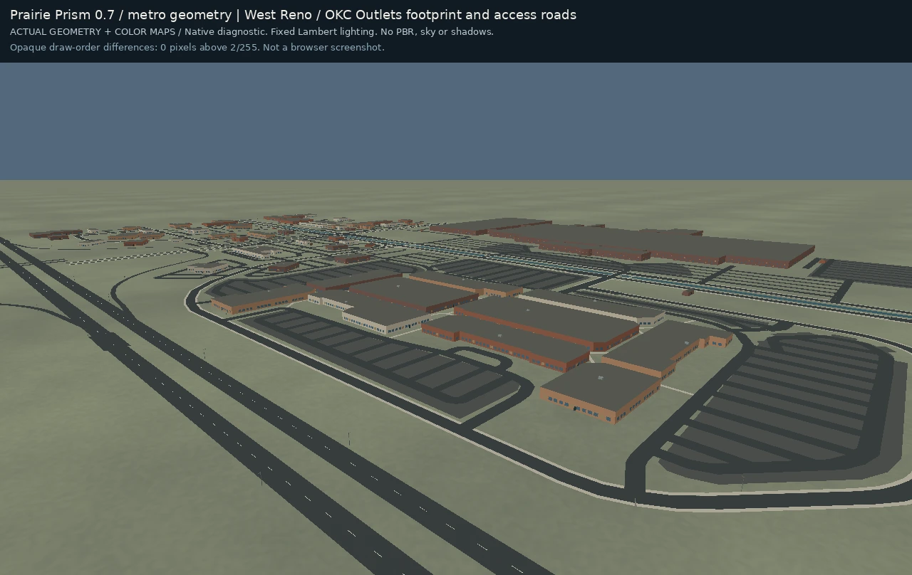
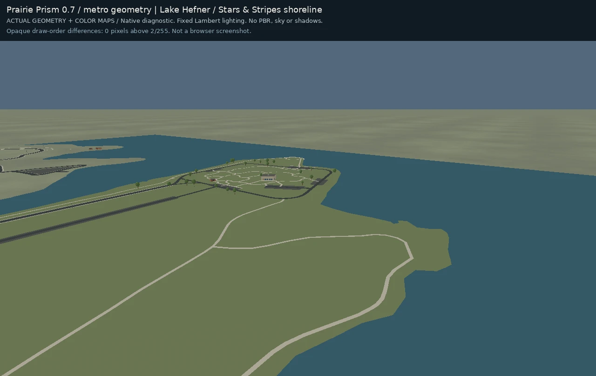

# Metro geometry evidence — V0.7

These five views inspect the actual streamed metro geometry for Yukon, Bethany,
West Reno and Lake Hefner. All five have **zero changed pixels** when the opaque
draw order is reversed, using the documented native depth test. The complete
atlas also passes the geographic and payload checks in `scripts/check-metro.py`.

The images are native EGL/GLES diagnostics with fixed Lambert lighting. They
are not browser screenshots, a photograph comparison, or an FPS benchmark.
The production atmospheric sky, PBR materials, shadow maps, point lights,
seasonal decorations, UI and driving are outside this inspection.

## What was inspected

| Evidence | Result |
|---|---:|
| Sampled tile neighborhoods | Four 3 × 3 neighborhoods, 36 distinct tiles |
| Building footprints compiled | 2,960 |
| Exported triangles | 204,841 |
| Exported vertices | 614,523, all finite |
| Material mesh batches | 494 |
| Trees at mapped source coordinates | 60 |
| Flat roof approximations | 2,176 |
| Gables inferred from simple residential footprints | 685 |
| Flat roofs with an OSM shape tag | 86 |
| Gables with an OSM shape tag | 13 |

The exported meshes come from the production `compileTile` function. Tree
instances use the production tile-scene implementation. Texture pixels come
from the same procedural material factories. The native renderer consumes the
resulting vertex positions, normals, UVs and color maps.

The selected tile sample ends in the distance. Straight cutoffs at the far edge
of the lake or city indicate that sample boundary; they do not establish the
runtime streaming radius or a complete lake view. Tree coverage follows mapped
OSM tree points and is incomplete. Tree canopy shape, façade openings and
unmeasured roof geometry are estimates.

## Views

### Yukon / Christmas in the Park surroundings

The paths, access roads, parking areas and mapped land regions remain distinct.
This view inspects the daytime source geometry around the seasonal destination;
Christmas light decorations are outside the native pass.



### Bethany / NW 39th street and neighborhood

This view checks the broad street network, mapped building footprints and roof
massing around the Bethany destination anchor.



### Bethany / inferred gable on a mapped footprint

The close-up checks that the gable stays inside its mapped footprint and joins
the walls. The exact building ID and roof source are recorded in `report.json`.
This roof is labeled as an inferred residential pitch, not surveyed architecture.



### West Reno / OKC Outlets

The outlet footprint and surrounding parking/access road layout are visible.
Storefront façade details are procedural estimates; the geometry test does not
confirm individual tenant entrances or current business operation.



### Lake Hefner / Stars & Stripes

The shoreline, paths, parking and source-mapped tree instances remain visible.
The distant straight water edge is the end of the selected tile neighborhood.



## Corrections verified

The offline road compiler now snaps both sides of the road/sidewalk partition
to the shared centimeter grid. A two-centimeter curb seam prevents tiny wedges
from returning when newly intersected edges are serialized. The full atlas
reports **0.0 m²** road/sidewalk overlap and **0.0 m²** metro road overlap with
the original downtown core. The strict overlap gate was retained.

Nested park, woodland and parking source polygons are valid geographic records.
Their previous equal render heights caused color conflicts in the native
inspection. The runtime now gives grass, forest and parking small separate
render offsets, all below the road deck. These are rendering offsets, not
surveyed terrain elevation. Their source polygon outlines remain unchanged.

The five final views report zero reversed-order differences above 2/255. This
checks these views on the recorded native renderer; it does not prove behavior
on every browser, GPU or camera position.

## Full atlas integrity

| Atlas quantity | Verified result |
|---|---:|
| Building footprints | 272,713 unique identities |
| Source roads | 82,114 |
| Routable source roads | 57,907 |
| Routing nodes | 218,875 |
| Points of interest | 7,799 |
| Curated destination records | 91, all located |
| Tile files | 3,004 raw and 3,004 gzip |
| Combined raw tile payload | 197,918,437 bytes |
| Combined gzip tile payload | 40,896,774 bytes |
| Tile payload reduction with gzip | 79.34% |
| Largest raw tile | 303,286 bytes |

Every raw and gzip tile and shared atlas payload passed byte count, SHA-256 and
decoded-identity checks. Building IDs are unique, POI building references resolve,
and the selected graph routes connect Yukon with Cactus Jack’s, Brickopolis,
Windsor Lanes and the NW 39th Subway anchor. This is a static routing graph;
live closures and turn-restriction relations remain outside it.

The atlas retains the source footprint snapshots and records height provenance.
Only 50 buildings have explicit OSM height values, and 2,160 use OSM floor counts
with an estimated floor pitch. Other heights are estimates. Most roof shapes
are also unrecorded in the source; this evidence does not convert those visual
estimates into measured architecture.

## Reproduce

After the complete offline build:

```sh
node scripts/visual/prepare-metro-diagnostics.mjs --dist dist --output /tmp/okc-metro-diagnostics --label 'Prairie Prism 0.7 / metro geometry'
python3 scripts/visual/render-city-diagnostics.py --input /tmp/okc-metro-diagnostics --output /tmp/okc-metro-render --width 1280
python3 scripts/check-metro.py
```

Texture export requires `@napi-rs/canvas`. Native rendering requires NumPy,
Pillow and system EGL/GLES, as does the existing city geometry diagnostic.
The atlas compiler and checker use the pinned build requirements.

`report.json` records the renderer, camera parameters, geometry counts/hash,
source module and atlas hashes, all 36 sampled tile hashes, texture hashes,
diagnostic script hashes, image hashes and full atlas validation results.
Large intermediate vertex buffers and texture exports remain outside Git.
