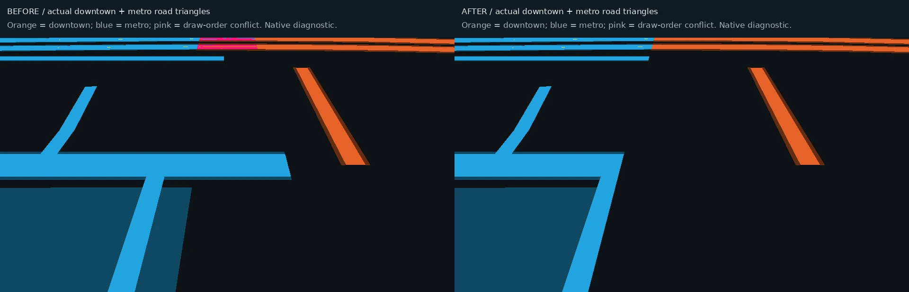

# Downtown / metro surface ownership

The v0.7.1 metro compiler excluded the downtown driving rectangle, while the
preserved downtown surface compiler included an additional **50 m apron**.
That mismatch produced **22,035.7164 m² of overlapping road triangles at the
same 0.14 m elevation**. It was an actual duplicate surface owner; changing
draw order could only choose which road material won.

Metro land records also rendered across the original downtown. The corrected
pipeline reserves the original downtown plus its apron for the existing city
surfaces. Building exclusion still uses the original driving rectangle.

## Correction

- `coreSurfaceBounds` explicitly records the surface owner, including its apron.
- The offline road/sidewalk union subtracts that full owner.
- Raw land polygons stay intact for the 2D atlas. A `renderPatches` field is
  stored only on affected records, carrying the exposed 3D portions.
- The runtime clips triangles against the same rectangle, so older tile data
  is safe too. It interpolates UVs, preserves winding and holes, and retains
  surviving portions even when all original triangle corners lie outside the
  excluded rectangle. It does not drop an entire crossing tile or polygon.
- Road deck, paint and lamp height use the same bridge/layer interpretation.
  This also keeps a bridge+tunnel record consistent with the offline compiler.

No depth bias, render-order override, Devon material, baseline capture or
original downtown triangle was changed for this correction.

## Actual geometry result

The probe decodes the built downtown vertex/index buffers, then runs the
production old and corrected metro compilers on the same 48 tiles surrounding
the complete downtown boundary. The old compiler comes from commit `6ae1e0e`.

| Measurement | v0.7.1 control | Corrected compiler |
|---|---:|---:|
| Equal-height downtown / metro road overlap | 22,035.7164 m² | **0.0 m²** |
| Metro flat triangles intruding into downtown surface ownership, summed area | 1,828,486.6955 m² | **0.0 m²** |
| Exported vertices | 435,666 | 402,330 |
| Nonfinite coordinates | 0 | 0 |

The second area sums individual triangle footprints, so nested source regions
can contribute more than once. It is an ownership assertion, not a land-area
estimate. Source and geometry-buffer hashes are in [report.json](report.json).

## Native depth check

The same actual buffers are rendered in original and reversed draw order.
Three camera views are checked with ordinary 24-bit depth, logarithmic 24-bit
depth, reversed 24-bit depth, and reversed 32-bit floating-point depth.

| Depth mode | Old control, maximum changed pixels across the three views | Corrected, maximum |
|---|---:|---:|
| Ordinary / 24-bit | 1,165 | **0** |
| Logarithmic / 24-bit | 25,146 | **0** |
| Reversed / 24-bit | 31,801 | **0** |
| Reversed / 32-bit float | 4,018 | **0** |

The original compiler is a real negative control: conflicts reproduce in every
tested depth mode. The corrected geometry is independent of draw order in all
12 view/depth combinations. One eye-level view was already stable before the
fix, which is why the test includes multiple camera positions.



The colors distinguish owners: orange is the original downtown, blue is metro,
and pink marks pixels that changed when draw order reversed. These are native
EGL/GLES diagnostics with flat owner colors. They do not show the game's final
appearance, execute browser shaders, or establish an FPS result. Ground-plane
shading, building façades, shadows and the atmospheric sky are outside this
focused surface test.

## Regression checks

`src/metro/runtime.test.mjs` covers interior rectangle subtraction, interpolated
UVs, upward normals, retained polygon holes, empty baked patches, legacy raw
tiles, road/paint ownership and the separate building boundary. It also checks
that worker-computed mesh bounds contain every emitted vertex. Fifteen runtime
tests passed after the change.

`scripts/check-metro-compiler.py` covers the road/sidewalk partition, source
polygon preservation, apron bounds, clipped render patches and deterministic
gzip. Four compiler tests passed. The full atlas checker now verifies the
original downtown's actual surface extent, zero metro intrusion into the apron,
and render-patch containment within its source polygon. It must be run after
the full release rebuild.

Worker mesh bounds are an independent mounting optimization. Adding bounds does
not modify the position, normal or UV buffers; the probe's position-buffer hash
remained unchanged. The conservative sphere is computed with the geometry off
the main thread.

## Reproduce the negative control

Use a separately built v0.7.1 data directory as `--data-dir`; a corrected atlas
already has the duplicate offline road region removed and cannot serve as the
old-data negative control. The current source compiler is loaded from this
checkout, and the old compiler is loaded from Git.

```sh
node scripts/visual/prepare-metro-surface-probe.mjs --data-dir /path/to/v071/dist --baseline 6ae1e0e --output /tmp/okc-metro-surface-probe
python3 scripts/visual/check-metro-surface-depth.py --input /tmp/okc-metro-surface-probe --output /tmp/okc-metro-surface-depth
```

The native check needs NumPy, Pillow, Shapely and system EGL/GLES with
`EXT_clip_control`. Large vertex buffers and baseline data remain outside Git;
the compact report records the exact hashes of all 48 sampled tiles.
